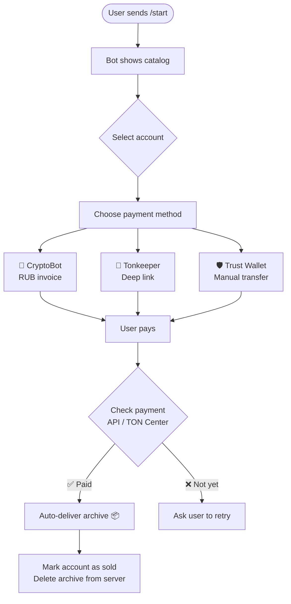

<div align="center">


<br/>

[](https://python.org)
[](https://docs.aiogram.dev)
[](https://ton.org)
[](https://t.me/CryptoBot)
[](LICENSE)

> **Fully automated Telegram bot for selling digital accounts (Tdata format) with multi-payment support — works 24/7 without any manual intervention.**

</div>

---

## ✨ Features

| Feature | Description |
|---|---|
| 🛒 **Auto-sell** | Automatically delivers product archive upon confirmed payment |
| 🤖 **CryptoBot** | RUB invoice via [@CryptoBot](https://t.me/CryptoBot) — any crypto |
| 💎 **Tonkeeper** | One-tap TON payment via deep link |
| 🛡️ **Trust Wallet** | Manual TON transfer with unique comment/memo |
| 🔄 **Auto-check** | Verifies transactions via TON Center API in real time |
| 📦 **Auto-delivery** | Sends zip/rar archive directly in chat after payment |
| 👤 **Admin Panel** | Add & remove accounts via `/add` and `/delete` commands |
| 🗄️ **SQLite DB** | Persistent storage for accounts and invoices |

---

## 🏗️ Project Structure

```
TG-bot/
├── main.py              # 🤖 Core bot logic & all handlers
├── config.py            # ⚙️  Loads config from .env (tokens, price)
├── database.py          # 🗄️  SQLite: accounts & invoices management
├── crypto_payment.py    # 💳 CryptoBot API integration
├── ton_payment.py       # 💎 TON Center API & exchange rate fetcher
├── requirements.txt     # 📦 Python dependencies
├── run_bot.bat          # 🚀 One-click launch (Windows)
├── .env.example         # 🔑 Config template (copy → .env)
├── config.example.py    # 🔑 Legacy config template
└── accounts/            # 📁 Folder for account archives (zip/rar)
```

---

## ⚙️ How It Works



---

## 🚀 Quick Start

### 1️⃣ Clone the repository

```bash
git clone https://github.com/bababuy1992-cmyk/TG-bot.git
cd TG-bot
```

### 2️⃣ Create virtual environment

```bash
python -m venv venv

# Windows:
venv\Scripts\activate

# Linux / Mac:
source venv/bin/activate
```

### 3️⃣ Install dependencies

```bash
pip install -r requirements.txt
```

### 4️⃣ Configure environment

```bash
# Copy the template
copy .env.example .env   # Windows
cp .env.example .env     # Linux/Mac
```

Open `.env` and fill in your values:

```env
TELEGRAM_TOKEN=YOUR_BOT_TOKEN        # from @BotFather
CRYPTOPAY_TOKEN=YOUR_CRYPTOPAY_TOKEN # from @CryptoBot → Crypto Pay
ADMIN_ID=123456789                   # your Telegram user ID
WALLET_ADDRESS=YOUR_TON_ADDRESS      # your TON wallet
TONCENTER_API_KEY=YOUR_KEY           # from toncenter.com
PRICE_TARGET_RUB=15                  # target price in rubles
```

#### Where to get each token:

| Variable | Source |
|---|---|
| `TELEGRAM_TOKEN` | [@BotFather](https://t.me/BotFather) → `/newbot` |
| `CRYPTOPAY_TOKEN` | [@CryptoBot](https://t.me/CryptoBot) → Crypto Pay → My Apps |
| `ADMIN_ID` | [@userinfobot](https://t.me/userinfobot) |
| `WALLET_ADDRESS` | Your Tonkeeper or Trust Wallet |
| `TONCENTER_API_KEY` | [toncenter.com/api](https://toncenter.com/api/v2/) |

### 5️⃣ Run the bot

**Windows:**
```bat
run_bot.bat
```

**Linux / Mac:**
```bash
python main.py
```

---

## 👨‍💼 Admin Commands

| Command | Description |
|---|---|
| `/add` | Add a new account: enter country → aging period → upload archive |
| `/delete` | Show all available accounts with delete buttons |

---

## 💳 Payment Flow

### CryptoBot
- Bot creates a RUB invoice via CryptoBot API
- User pays in any supported cryptocurrency (BTC, ETH, USDT, TON, etc.)
- Bot verifies payment status via `check_invoice_status()`
- Archive is delivered automatically ✅

### Tonkeeper
- Bot generates a deep link with wallet address + exact TON amount + memo
- User taps "Open in Tonkeeper" and pays in one tap
- Bot verifies via TON Center API ✅

### Trust Wallet
- Bot displays wallet address + amount + unique comment/memo
- User manually sends TON with exact memo
- Bot polls TON Center API for matching transaction ✅

---

## 🛠️ Tech Stack

| Layer | Technology |
|---|---|
| **Bot Framework** | [aiogram 3.12](https://docs.aiogram.dev) (async, FSM) |
| **Payments** | [aiocryptopay](https://github.com/vovchik33/aiocryptopay) + TON Center REST API |
| **Blockchain rates** | [CoinGecko API](https://coingecko.com) (TON/RUB live rate) |
| **Database** | SQLite (via `sqlite3` stdlib) |
| **Language** | Python 3.10+ |

---

## 🔒 Security Notes

> [!CAUTION]
> - **Never commit `.env` or `config.py` with real tokens** — they are protected by `.gitignore`
> - Keep `TONCENTER_API_KEY` private — it has rate-limit quota tied to your account
> - Rotate `TELEGRAM_TOKEN` via [@BotFather](https://t.me/BotFather) if you suspect it was leaked

---

## 📄 License

MIT License © 2026 [bababuy1992-cmyk](https://github.com/bababuy1992-cmyk)

---

<div align="center">

**Made with ❤️ and Python**

⭐ If you found this useful, give it a star!

</div>
